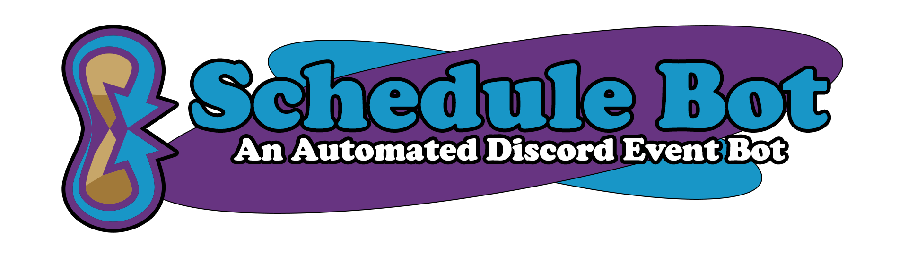
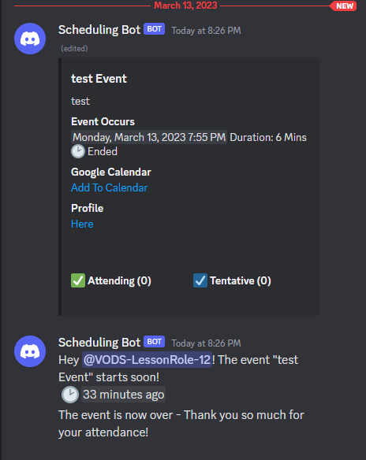

# ScheduleBot

<p align="center">
  
</p>

ScheduleBot is a self-hosted Discord bot for planning and running community events. It creates event cards, tracks attendance, manages event roles and threads, and produces CSV attendance reports.

## Features

- Create and edit events with Discord slash commands
- Track attending and tentative responses with buttons
- Create a temporary role and discussion thread for each event
- Announce events and clean them up automatically
- Export attendance reports as CSV files
- Store data in SQLite by default, with optional MySQL support



## Requirements

- Node.js 22.13 or newer for local installations
- A Discord application and bot token
- SQLite (included by default) or MySQL 8

### Discord setup

1. Enable **Server Members Intent** in the Discord Developer Portal.
2. Invite the bot with the `bot` and `applications.commands` scopes.
3. Grant the bot these permissions:
   - View Channels
   - Send Messages
   - Manage Messages
   - Manage Roles
   - Create Public Threads
   - Send Messages in Threads
   - Manage Threads
4. Keep the bot's role above any roles that it creates.

## Quick start

### Docker Compose

Docker Compose is the simplest way to run ScheduleBot. SQLite is used automatically unless `DATABASE_TYPE=mysql` is explicitly set.

```sh
cp .env.example .env
# Add your Discord bot token to .env
docker compose up -d --build
```

Run `/seteventchannel` in Discord after the bot starts.

SQLite data is stored in the `schedulebot-data` Docker volume. The service does not expose a host port; Docker checks the internal `/health` endpoint instead.

### Run locally

```sh
cp .env.example .env
# Add your Discord bot token to .env
npm ci
npm run build
npm start
```

By default, the SQLite database is created at `./data/schedulebot.sqlite3`. Change its location with `SQLITE_FILE`.

## Using MySQL

MySQL is only enabled when `DATABASE_TYPE` is explicitly set to `mysql`:

```env
DATABASE_TYPE=mysql
MYSQL_SERVER=db
MYSQL_DB=ScheduleBot
MYSQL_USER=schedulebot
MYSQL_USER_PW=a-strong-password
```

Start ScheduleBot and MySQL together with the Compose profile:

```sh
docker compose --profile mysql up -d --build
```

The database is only available on the private Compose network. The bot waits for MySQL to become healthy and creates any missing tables automatically.

Existing installations can continue using `MYSQL_SERVER`, `MYSQL_DB`, `MYSQL_USER`, and `MYSQL_USER_PW`. The aliases `MYSQL_DATABASE`, `MYSQL_PASSWORD`, and `DISCORD_BOT_CONNECTION_STRING` are also supported.

### Upgrading from the legacy bot

The TypeScript version keeps the original MySQL table and column names, including `Schedules`, `ServerSettings`, and the historical `Attenants` spelling. Existing Entity Framework-created tables are reused rather than replaced.

Before upgrading:

1. Stop the old bot.
2. Back up the database.
3. Test the new bot against a copy of the database.
4. Point ScheduleBot at the existing schema using the MySQL variables above.

Discord IDs remain `BIGINT UNSIGNED` in MySQL and are handled as strings in the application to prevent precision loss. Startup creates missing tables and safely adds the attendance uniqueness constraint after removing legacy duplicates.

Moving data between MySQL and SQLite is not automatic. Use an export/import tool that preserves table names, UTC timestamps, boolean values, primary keys, and Discord IDs.

## Commands

Commands require **Manage Messages** by default.

| Command                | Description                                          |
| ---------------------- | ---------------------------------------------------- |
| `/seteventchannel`     | Choose the channel where events are posted           |
| `/event`               | Create an event                                      |
| `/edit`                | Edit an event using its Discord message ID           |
| `/restartevent`        | Reactivate an ended event and restore attendee roles |
| `/refresh`             | Rebuild active event messages                        |
| `/getattendancereport` | Send the requester a CSV report for a date range     |
| `/version`             | Show the running ScheduleBot version                 |

Event cards include **Attend**, **Tentative**, and **Delete** buttons. Selecting your current attendance choice again removes it; selecting the other choice updates it. Deleting an event requires typed confirmation and a second authorization check.

One hour before an event, the scheduler creates its thread and posts an announcement. At the event's end time, the card is marked as ended. One hour later, the thread is archived and the temporary role is removed. These intervals can be changed in `.env.example`.

## Dates and time zones

ScheduleBot accepts ISO 8601 date/time values, preferably with an explicit offset:

```text
2026-04-15T19:00:00-04:00
```

Discord timestamps such as `<t:1776294000:F>` are also accepted. When an ISO value has no offset, ScheduleBot applies the command's IANA time zone, such as `America/New_York`. All values are stored and compared in UTC.

## Configuration

See [`.env.example`](.env.example) for every available setting.

Important defaults and safeguards:

- `DATABASE_TYPE` defaults to `sqlite` when omitted.
- MySQL must be selected explicitly with `DATABASE_TYPE=mysql`.
- Tokens and database credentials are never written to logs.
- Invalid or known placeholder credentials stop startup with a clear error.
- The Compose service uses a read-only root filesystem, drops Linux capabilities, limits process creation, and keeps only `/app/data` writable.

## Development

```sh
npm ci
npm run format:check
npm run lint
npm run typecheck
npm test
npm run build
npm audit --omit=dev
```

`npm test` runs the test suite with V8 coverage. To run the MySQL integration tests, set `RUN_MYSQL_INTEGRATION=true` along with `MYSQL_TEST_HOST`, `MYSQL_TEST_DATABASE`, `MYSQL_TEST_USER`, and `MYSQL_TEST_PASSWORD`.

> **Warning:** The MySQL integration suite resets its configured database. Never point it at production data.

CI runs formatting, linting, type checks, unit tests, MySQL integration tests, builds, dependency auditing, CodeQL, dependency review, and Trivy container scanning. Trusted pushes to `dev`, `master`, and `v*` tags publish multi-platform images to GitHub Container Registry only after validation and scanning succeed.

## License and support

ScheduleBot is available under the [MIT License](LICENSE.txt). Please use the GitHub issue tracker for support. Funding links are available in [`.github/FUNDING.yml`](.github/FUNDING.yml).
